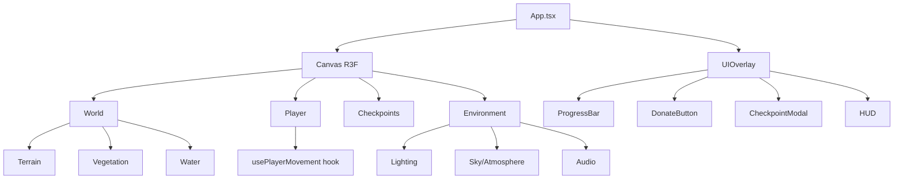

# Instituto Mais Água — 3D Gamified Web Experience

## Goal

Build an immersive 3D web application where users traverse a continuous map of the Brazilian sertão. As the player moves forward, the environment transforms from arid desert to lush, fertile land — visually demonstrating the impact of water. Interactive checkpoints explain real-world project stages, and a simulated donation system triggers visual world transformations.

## Tech Stack

| Technology | Purpose |
|---|---|
| **Vite** | Build tool & dev server |
| **React 18 + TypeScript** | UI framework |
| **React Three Fiber (R3F)** | 3D rendering (Three.js wrapper) |
| **@react-three/drei** | 3D helpers (Sky, Environment, Text, etc.) |
| **Zustand** | Global state management |
| **@stripe/stripe-js** (mock) | Simulated donation integration |

## Architecture Overview



## Proposed Changes

### 1. Project Setup

#### [NEW] package.json / vite.config.ts / tsconfig.json
- Initialize with `npx -y create-vite@latest ./ --template react-ts`
- Install dependencies:
  - `@react-three/fiber` `@react-three/drei` `three` `@types/three`
  - `zustand`
  - `@stripe/stripe-js` (mock only)

---

### 2. State Management (Zustand)

#### [NEW] src/store/useGameStore.ts
Global store managing:
- `playerPosition: [x, y, z]` — current player position
- `progress: number` (0–1) — calculated from player Z position
- `donationTotal: number` — total simulated donations
- `donationProgress: number` (0–1) — donation progress bar
- `activeCheckpoint: CheckpointData | null` — currently triggered checkpoint
- `visitedCheckpoints: Set<string>` — already visited checkpoints
- `setPlayerPosition()`, `donate(amount)`, `activateCheckpoint()`, `dismissCheckpoint()`

---

### 3. World Components

#### [NEW] src/components/World/Terrain.tsx
- Procedurally generated low-poly terrain using `PlaneGeometry` with vertex displacement
- Color transitions based on `progress`:
  - Zone 1 (0–0.33): Sandy/cracked earth tones (`#C2A66B` → `#8B7355`)
  - Zone 2 (0.33–0.66): Transitional greens (`#8B9A6B` → `#6B8E3F`)
  - Zone 3 (0.66–1.0): Lush green (`#4CAF50` → `#2E7D32`)
- Vertex colors applied per-vertex based on Z position
- Terrain dimensions: ~200 units long (Z axis), ~60 units wide (X axis)

#### [NEW] src/components/World/Vegetation.tsx
- Instanced meshes for performance (trees, cacti, bushes, grass)
- Tree types vary by zone:
  - Zone 1: Dead trees (bare trunk + branches, brown/gray)
  - Zone 2: Small shrubs, sparse green trees
  - Zone 3: Full canopy trees, flowers, tall grass
- Uses `InstancedMesh` for GPU-efficient rendering
- Opacity/scale interpolated based on progress for smooth transitions

#### [NEW] src/components/World/Water.tsx
- Water bodies that appear as progress increases:
  - Zone 1: Dry riverbed (visible cracked terrain)
  - Zone 2: Small puddles, thin stream
  - Zone 3: Flowing river with animated water
- `MeshStandardMaterial` with transparency and animated UVs
- Uses `useFrame` for gentle wave animation

#### [NEW] src/components/World/World.tsx
- Parent component composing Terrain, Vegetation, Water
- Passes progress data down

---

### 4. Player System

#### [NEW] src/hooks/usePlayerMovement.ts
- Keyboard input handler (WASD + Arrow keys)
- Movement speed: ~5 units/second
- Smooth acceleration/deceleration using lerp
- Boundary clamping (keep player within terrain)
- Updates store position each frame via `useFrame`

#### [NEW] src/components/Player/Player.tsx
- Simple low-poly character (geometric shapes: capsule body + sphere head)
- Built with R3F primitives (no external model needed)
- Rotation to face movement direction
- Simple walking animation (bob up/down)

#### [NEW] src/components/Player/CameraRig.tsx
- Third-person camera that follows player
- Smooth follow with `useFrame` + lerp
- Offset: `[0, 8, -12]` behind and above
- Look-at target slightly ahead of player

---

### 5. Environment & Atmosphere

#### [NEW] src/components/Environment/Lighting.tsx
- Dynamic lighting that transitions:
  - Zone 1: Harsh, warm sunlight (high intensity, orange tint)
  - Zone 2: Neutral daylight
  - Zone 3: Soft, golden-hour light with ambient warmth
- `DirectionalLight` + `AmbientLight` with color/intensity interpolation
- Optional: `HemisphereLight` for sky/ground color separation

#### [NEW] src/components/Environment/Atmosphere.tsx
- Uses `@react-three/drei` `Sky` component
- Sky parameters transition:
  - Zone 1: Hazy, washed-out sky
  - Zone 2: Clearing sky
  - Zone 3: Vibrant blue sky with clouds
- Optional fog that thins as progress increases
- Background color transitions

#### [NEW] src/components/Environment/AudioManager.tsx
- Uses Web Audio API via React refs
- Three audio layers that crossfade based on progress:
  - Layer 1: Dry wind (zone 1)
  - Layer 2: Water/stream sounds (zone 2)
  - Layer 3: Birds + nature (zone 3)
- Volume control via Zustand
- Auto-play on first user interaction (browser policy)

> [!NOTE]
> Audio files will be simple oscillator-based or generated programmatically to avoid large asset downloads. We can use the Web Audio API's `OscillatorNode` and `AudioBufferSourceNode` with procedurally generated noise for wind/water sounds.

---

### 6. Checkpoints

#### [NEW] src/components/Checkpoints/Checkpoint.tsx
- Glowing marker in 3D space (pulsing light/ring)
- Collision detection: distance-based (player within radius)
- Triggers `activateCheckpoint()` in store
- Visual states: inactive, active (pulsing), visited (dimmed)

#### [NEW] src/components/Checkpoints/CheckpointData.ts
Four checkpoints along the Z axis:
1. **Perfuração de Poço** (z ≈ 50): "O primeiro passo é perfurar um poço artesiano..."
2. **Instalação de Bomba** (z ≈ 100): "Com o poço pronto, instalamos uma bomba..."
3. **Tratamento de Água** (z ≈ 140): "A água passa por tratamento..."
4. **Distribuição** (z ≈ 180): "Finalmente, a água chega às famílias..."

---

### 7. UI Overlay

#### [NEW] src/components/UI/UIOverlay.tsx
- Container for all 2D UI elements overlaid on the 3D canvas
- Uses CSS `position: fixed` with `pointer-events: none` (selective enable)

#### [NEW] src/components/UI/ProgressBar.tsx
- Horizontal bar showing donation progress
- Animated fill with gradient
- Shows percentage and amount text
- Glassmorphism styling

#### [NEW] src/components/UI/DonateButton.tsx
- Fixed position, always visible
- Pulsing animation to draw attention
- Opens donation modal on click
- Shows quick amounts: R$ 10, R$ 25, R$ 50, R$ 100

#### [NEW] src/components/UI/DonationModal.tsx
- Full donation form (simulated)
- Amount selection + custom input
- Simulated Stripe checkout flow
- Success animation on "payment"
- Triggers world transformation effects

#### [NEW] src/components/UI/CheckpointModal.tsx
- Appears when player reaches a checkpoint
- Shows title, description, icon
- "Continuar" button to dismiss
- Fade in/out animation

#### [NEW] src/components/UI/HUD.tsx
- Controls legend (WASD)
- Current zone indicator
- Mini progress indicator

---

### 8. Main App

#### [NEW] src/App.tsx
- Root component
- R3F `<Canvas>` with all 3D components
- UI overlay outside canvas
- Font import (Inter from Google Fonts)

#### [NEW] src/main.tsx
- React entry point
- StrictMode wrapper

#### [NEW] src/index.css
- Global styles
- CSS variables for theming
- Glassmorphism utilities
- Animation keyframes
- Responsive breakpoints

---

### 9. Hooks

#### [NEW] src/hooks/useProgress.ts
- Derives progress (0–1) from player Z position
- Provides `currentZone` (1, 2, or 3)
- Provides interpolated values for colors, lighting, etc.
- Memoized lerp utilities

---

## Key Design Decisions

> [!IMPORTANT]
> **No external 3D models**: All geometry is built with R3F primitives and procedural generation. This keeps the bundle tiny and avoids GLTF loading complexity. Trees, cacti, and the player character are all built from basic shapes (cylinders, cones, spheres, boxes).

> [!IMPORTANT]
> **Procedural audio**: Instead of loading audio files (which add to bundle size and have CORS issues), we'll generate ambient sounds programmatically using the Web Audio API. Wind = filtered white noise, Water = layered oscillators, Birds = frequency-modulated oscillators with randomized patterns.

> [!NOTE]
> **Performance strategy**: InstancedMesh for vegetation (hundreds of trees rendered in 1 draw call), vertex colors instead of texture maps, simple geometries, and fog to limit draw distance.

## File Structure

```
src/
├── main.tsx
├── App.tsx
├── index.css
├── store/
│   └── useGameStore.ts
├── hooks/
│   ├── usePlayerMovement.ts
│   └── useProgress.ts
├── components/
│   ├── World/
│   │   ├── World.tsx
│   │   ├── Terrain.tsx
│   │   ├── Vegetation.tsx
│   │   └── Water.tsx
│   ├── Player/
│   │   ├── Player.tsx
│   │   └── CameraRig.tsx
│   ├── Environment/
│   │   ├── Lighting.tsx
│   │   ├── Atmosphere.tsx
│   │   └── AudioManager.tsx
│   ├── Checkpoints/
│   │   ├── Checkpoint.tsx
│   │   └── CheckpointData.ts
│   └── UI/
│       ├── UIOverlay.tsx
│       ├── ProgressBar.tsx
│       ├── DonateButton.tsx
│       ├── DonationModal.tsx
│       ├── CheckpointModal.tsx
│       └── HUD.tsx
└── utils/
    └── colors.ts
```

## Verification Plan

### Automated Tests
- `npm run build` — ensure TypeScript compiles without errors
- `npm run dev` — verify dev server starts and renders

### Manual / Browser Verification
- Open in browser and verify:
  1. 3D scene renders with terrain, vegetation, and sky
  2. Player moves with WASD keys, camera follows smoothly
  3. Terrain color transitions from brown to green as player moves forward
  4. Trees change from dead to alive across zones
  5. Water appears in zone 2 and flows in zone 3
  6. Checkpoints trigger modal popups
  7. Donate button opens donation modal
  8. Donation triggers visual world changes
  9. Audio plays and transitions between zones
  10. UI is responsive and overlays correctly
